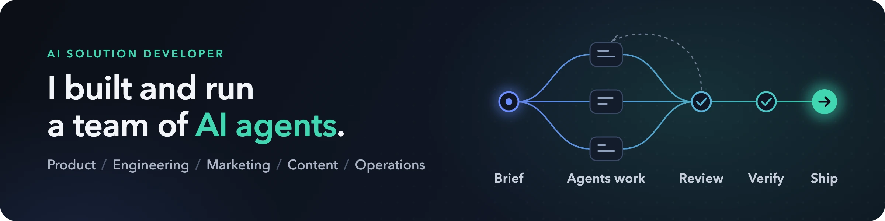
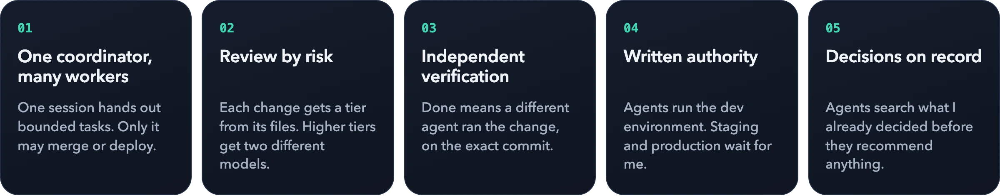
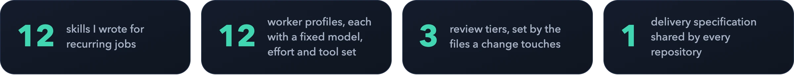
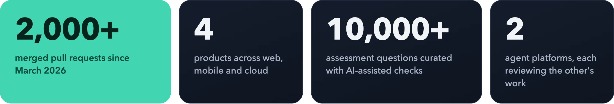
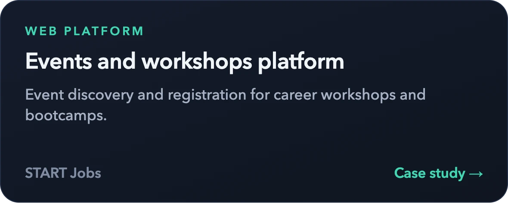
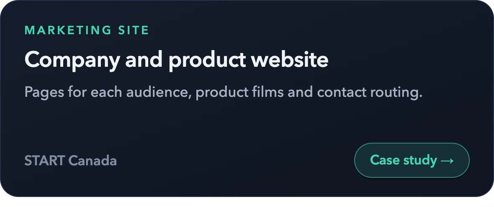
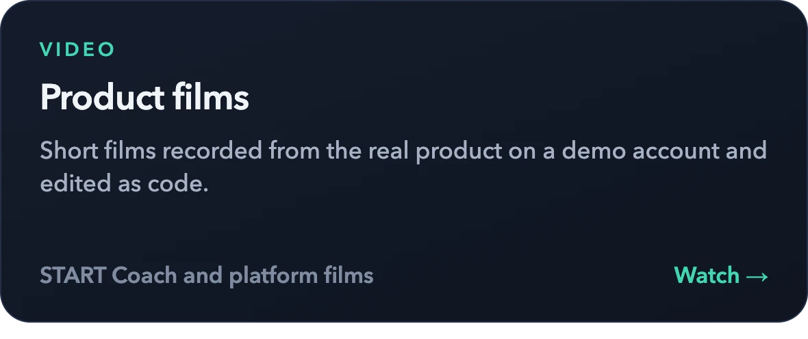
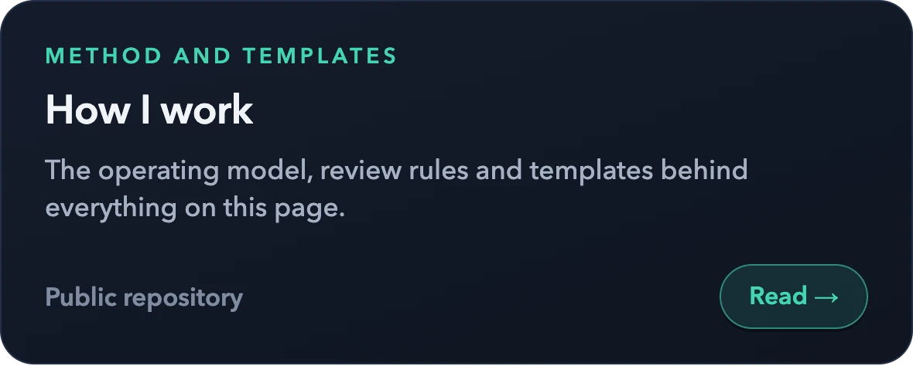

# Goksel Kacaroglu

**AI Solution Developer. I work across product, engineering, marketing, content and operations with AI agents.**

I work with a team of AI agents that I set up and direct. A lot of my work goes into the setup they work under. I built it over months of daily use on real products, and I still change it as I learn. It covers what an agent may do alone, skills for recurring jobs, review levels set by risk, and an independent check before anything ships.

My part is planning the work, splitting it between agents, checking their reviews and deciding what gets built and what ships. The agents do most of the hands-on work. They write and review code, draft marketing copy, cut product films, prepare documents and handle daily operations.

My background is in data analysis, business analysis, e-commerce and marketing, so I start from the user and the business case and work back to the technical choice.

&nbsp;
&nbsp;

## What I do

## How I work

Agents are good at a lot of this work, but early on I kept fixing the same kinds of mistakes. These five rules are what I found I needed, each one added after something went wrong without it.

The rules in full, with the templates I use, are in [how-i-work](https://github.com/gokselkacar/how-i-work).

## Where I do this now

I am the AI Solution Developer at StartNew Technologies, where I have worked since October 2025. I lead product for its career-readiness platform, events platform, boat marketplace and company website, and I run the agent workflow that builds and operates them.

That day-to-day activity is under my work account, [START-Canada](https://github.com/START-Canada), in private repositories.

## Selected work

Work for StartNew Technologies and my own projects. The source is private, so each product card opens a public case study in [selected-products](https://github.com/gokselkacar/selected-products).

## What I learned setting this up

Most of this came from running agents every day on real products and fixing what broke.

- Agents need written limits. For each environment there is a short list of what they may do alone and what waits for me.
- The agent that writes a change should not be the one that says it works.
- Review effort follows risk. Documentation changes get a light review, and risky parts of the code get more.
- Parallel agents multiply whatever process you already have, good or bad.
- The same habits carry over to copy, films and documents. A draft is still a draft until I have read it.

[The order I would set it up in again](https://github.com/gokselkacar/how-i-work/blob/main/docs/07-where-to-start.md)

## Tools and context

| Area | Context |
| --- | --- |
| Product and UX | Requirements analysis, stakeholder communication, user journeys, A/B testing, Jira |
| AI-assisted delivery | Codex, Claude Code, agent instructions and skills, model selection, review and verification |
| Web, mobile and cloud | Next.js, React, React Native, Expo, TypeScript, AWS, PostgreSQL, REST and GraphQL |
| Content and media | Remotion, scripted browser recording, ffmpeg |
| Data and analytics | Python, SQL, R, Google BigQuery, Tableau, Power BI |

Earlier data work

My [portfolio](https://github.com/gokselkacar/portfolio) holds independent analyses and notebooks from before my product role.

- [MSU Library button-label analysis](https://github.com/gokselkacar/portfolio/tree/main/AB_Testing_Project_Chi_Square_Test): compared click-through data for five navigation labels with chi-square tests and made a follow-up UX recommendation.
- [K-means customer segmentation](https://github.com/gokselkacar/portfolio/tree/main/Customer%20Segmentation%20Using%20the%20K-means%20Algorithm%20for%20Targeted%20Marketing%20Strategies): explored the Mall Customers dataset, compared customer groups and proposed marketing hypotheses.
- [Bidding strategy A/B analysis](https://github.com/gokselkacar/portfolio/tree/main/AB_Testing_Project_Two_Sample_T_Test)
- [E-commerce ratings and review analysis](https://github.com/gokselkacar/portfolio/tree/main/Amazon_Rating_Products_Sorting_Reviews)
- [Customer segmentation analysis](https://github.com/gokselkacar/portfolio/tree/main/Customer_Segmentation_Process)
- [Customer lifetime value modeling](https://github.com/gokselkacar/portfolio/tree/main/Customer_Lifetime_Value_Prediction)
- [Relational music catalog](https://github.com/gokselkacar/portfolio/tree/main/Music_Library_Database)
- [QuickR package](https://github.com/gokselkacar/portfolio/tree/main/QuickR%20Package)
- [Stock price forecasting exploration](https://github.com/gokselkacar/portfolio/tree/main/Stock%20Price%20Prediction%20Tool)

