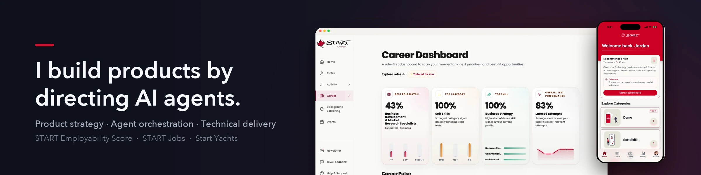

# Goksel Kacaroglu

**AI Solution Developer at StartNew Technologies | Product Strategy, AI Agent Orchestration & Technical Delivery**

I build software products by directing AI coding agents. I decide what to build and why, turn stakeholder needs into requirements and user journeys, and run the agent workflow that writes, reviews and ships the code.

I've been at StartNew Technologies since October 2025. Before that I worked in data analysis, business analysis, e-commerce and marketing, which is why I tend to start from the user and the business case and work back to the technical choice.

| Measure | To date |
| --- | --- |
| Products | 4 private product repositories across web, mobile and cloud |
| Merged pull requests | 2,000+ since March 2026, about 1,600 of them since September 2026 |
| Agent platforms | Codex and Claude Code, each reviewing the other's work |
| Assessment content | 10,000+ questions curated with AI-assisted quality checks |

## How I work

- **One coordinator, many workers.** I talk to one agent session. It hands bounded tasks to workers and is the only one that may merge or deploy.
- **Review by risk.** Every change gets a tier from the files it touches. Higher tiers get two different models reviewing them.
- **Independent verification.** A change is done when an agent that did not write it has run it and the checks pass on the exact commit.
- **Written authority.** Agents run the dev environment themselves. Staging and production wait for my approval, one action at a time.
- **Decisions on record.** Agents search what I already decided before they recommend anything, so I don't answer the same question twice.

The full method, with templates you can copy, is in [how-i-work](https://github.com/gokselkacar/how-i-work).

My day-to-day development activity is under my work account, [START-Canada](https://github.com/START-Canada), in private repositories.

## Selected product work

Case studies for products whose source is private are in [selected-products](https://github.com/gokselkacar/selected-products).

- [START Employability Score Platform](https://github.com/gokselkacar/selected-products/blob/main/products/start-employability-score-application.md): Career-readiness workflows across web and mobile, including assessments, AI coaching, resume analysis and interview simulation. [Product overview](https://startnew.ca/projects#employability-score).
- [START Jobs](https://github.com/gokselkacar/selected-products/blob/main/products/start-jobs-career-readiness-events-platform.md): Event discovery, workshops and bootcamp registration, being connected to the wider START career-readiness experience. [Website](https://startjobs.ca/).
- [Start Yachts](https://github.com/gokselkacar/selected-products/blob/main/products/start-yachts-project.md): A separate boat and yacht marketplace with listing discovery, detail pages and contact workflows. [Website](https://www.startyachts.com/).
- [START Canada Marketing Site](https://github.com/gokselkacar/selected-products/blob/main/products/start-canada-marketing-site.md): Program discovery, product presentation and contact journeys. [Website](https://startnew.ca/).
- [Options Master](https://github.com/gokselkacar/selected-products/blob/main/products/options-master.md): A personal options-research and paper-journal product. No live trade execution.
- [Seed Jewelry](https://github.com/gokselkacar/selected-products/blob/main/products/seed-jewelry.md): A product concept with biodegradable jewelry, an interactive configurator and a planting map.

## Setting up AI workflows

Most of what I've learned about coding agents came from running them every day on real products and fixing what broke. If your team is starting out, these are the questions I can help with:

- what agents may do alone, and what needs a person;
- how to review and verify agent-written code so it can be trusted;
- how to split work between a coordinator and parallel workers;
- which guards to add first, and which rules to write down;
- how to choose models and keep usage and CI costs in check.

[Where to start](https://github.com/gokselkacar/how-i-work/blob/main/docs/07-where-to-start.md) gives the order I would do it in. If you want to compare notes, message me on LinkedIn.

## Product and technical context

I work with these technologies through product definition, architecture review, AI-assisted implementation and verification.

| Area | Context |
| --- | --- |
| Product and UX | Requirements analysis, stakeholder communication, user journeys, A/B testing, Jira |
| AI-assisted delivery | Codex, Claude Code, agent instructions and skills, model selection, review and verification |
| Web, mobile and cloud | Next.js, React, React Native, Expo, TypeScript, AWS, PostgreSQL, REST and GraphQL |
| Data and analytics | Python, SQL, R, Google BigQuery, Tableau, Power BI |

## Earlier data work

My [portfolio](https://github.com/gokselkacar/portfolio) holds independent analyses and notebooks from before my product role.

- [MSU Library button-label analysis](https://github.com/gokselkacar/portfolio/tree/main/AB_Testing_Project_Chi_Square_Test): Compared click-through data for five navigation labels with chi-square tests and made a follow-up UX recommendation.
- [K-means customer segmentation](https://github.com/gokselkacar/portfolio/tree/main/Customer%20Segmentation%20Using%20the%20K-means%20Algorithm%20for%20Targeted%20Marketing%20Strategies): Explored the Mall Customers dataset, compared customer groups and proposed marketing hypotheses.

More public projects

- [Bidding strategy A/B analysis](https://github.com/gokselkacar/portfolio/tree/main/AB_Testing_Project_Two_Sample_T_Test)
- [E-commerce ratings and review analysis](https://github.com/gokselkacar/portfolio/tree/main/Amazon_Rating_Products_Sorting_Reviews)
- [Customer segmentation analysis](https://github.com/gokselkacar/portfolio/tree/main/Customer_Segmentation_Process)
- [Customer lifetime value modeling](https://github.com/gokselkacar/portfolio/tree/main/Customer_Lifetime_Value_Prediction)
- [Relational music catalog](https://github.com/gokselkacar/portfolio/tree/main/Music_Library_Database)
- [QuickR package](https://github.com/gokselkacar/portfolio/tree/main/QuickR%20Package)
- [Stock price forecasting exploration](https://github.com/gokselkacar/portfolio/tree/main/Stock%20Price%20Prediction%20Tool)

## Contact

- [LinkedIn](https://www.linkedin.com/in/gokselkacaroglu/)
- [goksel.kacar@hotmail.com](mailto:goksel.kacar@hotmail.com)
